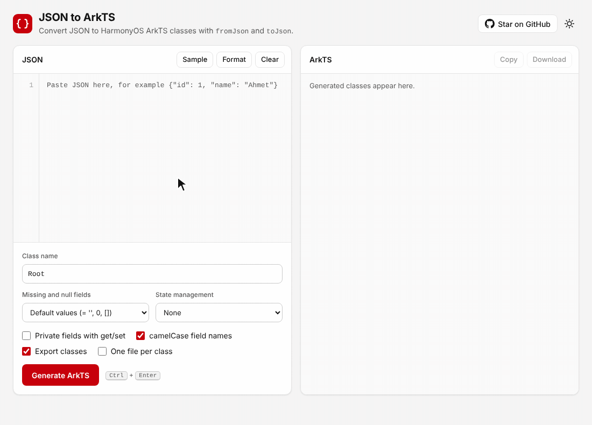

# JSON to ArkTS

[English](README.md) | **简体中文**

**把 JSON 转换为 HarmonyOS（鸿蒙）、HarmonyOS NEXT 和 OpenHarmony 的 ArkTS 类。** 粘贴一段 JSON 响应，即可得到带有 `fromJson()` 和 `toJson()` 的强类型 `.ets` 模型类，并能通过 DevEco Studio 中的 ArkTS 严格模式检查。免费、在线使用，全部在浏览器中运行。

### [打开 JSON to ArkTS →](https://ahmetkadircicek.github.io/json-to-arkts/)



如果 JSON to ArkTS 帮你节省了时间，欢迎点一个 ⭐，让更多鸿蒙开发者发现它。

ArkTS 不允许使用 `any`、`unknown` 和无类型的对象字面量，因此鸿蒙应用读取的每个 JSON 响应都需要一个有类型的模型类。手写这些类既费时又容易出错。JSON to ArkTS 会替你生成它们，包括嵌套对象和列表。

## 功能

- **ArkTS 模型类**：包含 `static fromJson()` 和 `toJson()`，支持任意层级的嵌套对象和列表。如果只需要类型，也可以生成纯 **interface**（`JSON.parse(text) as Root`）。
- **通过 ArkTS 严格模式**：不使用 `any` 或 `unknown`，所有对象字面量都声明为 `Record<string, Object>`，lambda 参数均有类型。每一种选项组合都经过 ArkTS linter 检查。
- **状态管理**：`@Observed`（V1），或 `@ObservedV2` 配合 `@Trace`（V2，API 12+）。
- **空值处理**：默认值、可选字段（`name?: string`）或可空字段（`name: string | null`）。
- **私有字段**及 getter/setter、**camelCase** 字段名、**每个类一个文件**并自动生成相互之间的 import。
- **智能命名**：类名使用大驼峰（UpperCamelCase），列表元素使用单数（`categories` → `Category`），并避免与 ArkUI 组件或装饰器重名（`Image`、`List`、`Text`、`Link` 等）。
- **提示**：对样例无法确定的情况给出提示，例如始终为 `null` 的值、空列表、混合类型、超出 `number` 精度的数字。
- JSON 错误显示行号和列号，支持格式化、语法高亮、复制、下载 `.ets` 或 `.zip`，以及浅色/深色主题。
- **隐私**：转换全部在浏览器中完成，你的 JSON 和代码不会被上传。

## 示例

```json
{ "id": 1, "user_name": "ahmet", "address": { "city": "Istanbul" }, "orders": [{ "total": 9.9 }] }
```

会生成

```ts
export class Root {
  id: number = 0;
  userName: string = '';
  address: Address = new Address();
  orders: Order[] = [];

  static fromJson(json: Record<string, Object>): Root {
    const model: Root = new Root();
    model.id = (json['id'] ?? 0) as number;
    model.userName = (json['user_name'] ?? '') as string;
    if (json['address']) {
      model.address = Address.fromJson(json['address'] as Record<string, Object>);
    }
    if (json['orders']) {
      model.orders = (json['orders'] as Record<string, Object>[]).map((item: Record<string, Object>) => Order.fromJson(item));
    }
    return model;
  }

  toJson(): Record<string, Object> {
    const json: Record<string, Object> = {};
    json['id'] = this.id;
    json['user_name'] = this.userName;
    json['address'] = this.address.toJson();
    json['orders'] = this.orders.map((item: Order) => item.toJson());
    return json;
  }
}

export class Address { ... }
export class Order { ... }
```

## 在鸿蒙项目中使用

1. 打开 [JSON to ArkTS](https://ahmetkadircicek.github.io/json-to-arkts/)，粘贴一段响应样例并设置类名。
2. 把 `.ets` 文件（或每个类一个文件的 `.zip`）下载到你的模块中，例如 `entry/src/main/ets/model/`。
3. 解析与序列化：

```ts
import { Root } from '../model/Root';

const root: Root = Root.fromJson(JSON.parse(text) as Record<string, Object>);
const output: string = JSON.stringify(root.toJson());
```

如果顶层是列表：

```ts
const list: Root[] = (JSON.parse(text) as Record<string, Object>[])
  .map((item: Record<string, Object>) => Root.fromJson(item));
```

## 选项

| 选项 | 作用 |
| --- | --- |
| Class name | 顶层类的名称。 |
| Output | **Class**：带 `fromJson` 和 `toJson` 的类。**Interface**：只有类型的 `export interface`，用法是 `JSON.parse(text) as Root`。interface 没有默认值、装饰器和方法，字段名就是 JSON 的键，因此状态管理、私有字段和 camelCase 选项会被关闭。 |
| Missing and null fields | **Default values**：`name: string = ''`，缺失或为 null 的键保留默认值。**Optional**：`name?: string`，读取为 `undefined`。**Nullable**：`name: string \| null = null`，读取为 `null`。`toJson` 会省略值为 `undefined` 和 `null` 的字段。 |
| State management | 每个类加上 **@Observed**（V1）；或每个类加 **@ObservedV2**、每个字段加 **@Trace**（V2，API 12+）。 |
| Private fields with get/set | `private _name`，并生成 `get name()` 和 `set name()`。 |
| camelCase field names | `user_name` 变为 `userName`；`fromJson` 和 `toJson` 仍使用原始 JSON 键。关闭时保留原键，只把它转换为合法标识符（`first-name` 变为 `first_name`）。 |
| Export classes | `export class`。 |
| One file per class | 每个类生成一个 `.ets` 文件并带有相互之间的 import，以标签页显示，并以 `.zip` 下载。 |

## JSON 如何转换为 ArkTS

- 每个 JSON 对象对应一个类。数字为 `number`，字符串为 `string`，布尔值为 `boolean`。
- 列表中的对象会被合并：类包含所有元素中出现过的键。名称相同且键和类型都相同的对象共用一个类。
- 类名是大驼峰形式的键名，列表元素使用单数。如果名称会遮蔽 ArkTS 全局对象或 ArkUI 组件、装饰器，就在前面加上父类名（`ProductImage`）；同名但结构不同的对象也这样处理，仍然冲突时再加数字。
- 样例无法确定的类型使用 `Object`，并给出提示：始终为 `null` 的值、空列表、混合类型的列表或键。
- 与类已有成员同名的字段（`constructor`、`fromJson`、`toJson`）在末尾加 `Value`，以数字开头的名称前面加 `_`，重名的加数字。所有被重命名的字段都会在提示中列出。

## 常见问题

**如何在 ArkTS 中解析 JSON？**
把解析结果转换为 `Record<string, Object>`，再传给生成的 `fromJson`：`User.fromJson(JSON.parse(text) as Record<string, Object>)`。要把模型转回文本，调用 `JSON.stringify(user.toJson())`。

**为什么不直接把 `JSON.parse` 的结果断言（as）为类？**
类型断言不会创建实例。得到的对象没有方法、没有默认值，也没有 `@Observed` 代理，因此 UI 不会响应它的变化。`fromJson` 会构建真正的类实例，嵌套对象和列表也一样。

**生成的代码能通过 ArkTS 严格模式吗？**
可以。`npm test` 使用 [`ohos-typescript`](https://www.npmjs.com/package/ohos-typescript)（DevEco Studio 编译 ArkTS 所用的 TypeScript 分支）及其 ArkTS linter，对 4 个样例文件的全部 120 种选项组合（类 108 种，interface 12 种）进行检查，并实际运行生成的类，确认 `toJson(fromJson(json))` 能还原出原始 JSON。

**用 class 还是 interface？**
如果只是读取字段总是齐全的数据，用 interface 就够了。需要缺失键的默认值、`@Observed`/`@ObservedV2` 状态、字段重命名，或需要 `toJson` 回传数据时，用 class：interface 只在编译时检查，缺失的键在运行时会是 `undefined`。

**用 `@Observed` 还是 `@ObservedV2`？**
状态管理 V1 中使用 `@Observed` 配合 `@ObjectLink`。V2（API 12 及以上）请选择 `@ObservedV2`：每个字段都会加上 `@Trace`，嵌套对象的变化也能刷新 UI。

**支持 OpenHarmony 和 HarmonyOS NEXT 吗？**
支持。它们都使用 ArkTS，生成的类在其中任何一个上都能使用。

## 隐私

转换器在你的浏览器中运行。你的 JSON、生成的代码和选项都不会离开浏览器；最近一次的 JSON 和选项只保存在浏览器的本地存储中。

线上站点使用 [Cloudflare Web Analytics](https://www.cloudflare.com/web-analytics/) 统计访问量，不使用 Cookie，也不做浏览器指纹识别；Cloudflare 不存储 IP 地址。它只记录访问的页面、来源网站、国家和浏览器类型，从不记录 JSON 或代码。统计脚本只在线上站点加载；在自动化浏览器中，或浏览器开启了 Do Not Track 或 Global Privacy Control 时，都不会加载。详见 `src/analytics.js`。

## 开发

纯 HTML、CSS 和 JavaScript 模块；无需构建，没有运行时依赖。

```sh
npm install
npm start      # http://localhost:8080
npm test
```

| 文件 | 作用 |
| --- | --- |
| `src/json-parser.js` | 严格的 JSON 解析器：保留键的顺序和数字原文，报错时给出行号和列号，并提供格式化。 |
| `src/converter.js` | 类型推断、类结构和 ArkTS 代码生成。 |
| `src/names.js` | 标识符、camelCase、单数形式和保留名称的规则。 |
| `src/app.js` | 页面逻辑。`src/highlight.js` 负责代码高亮，`src/zip.js` 生成 `.zip`，`src/analytics.js` 加载访问统计。 |
| `tool/og.html` | 链接预览图；用 `npx playwright screenshot --viewport-size=1200,630 tool/og.html og.png` 生成。 |

## 部署

`.github/workflows/pages.yml` 在每次 push 和 pull request 时运行测试。推送到 `main` 后，它会用站点文件（`index.html`、`src/`、`favicon.svg`、`og.png`、`sitemap.xml` 以及 Google Search Console 验证文件）替换 `gh-pages` 分支，由 GitHub Pages 提供访问。

## 致谢

作者 [Ahmet Kadir Çiçek](https://github.com/ahmetkadircicek)。

## 许可证

[MIT](LICENSE) © Ahmet Kadir Çiçek
